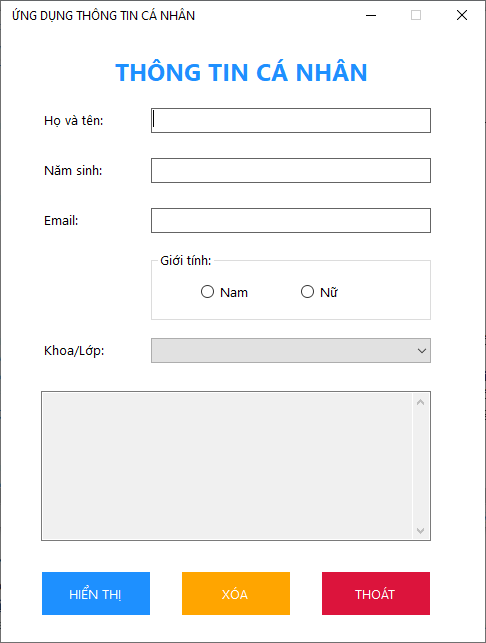
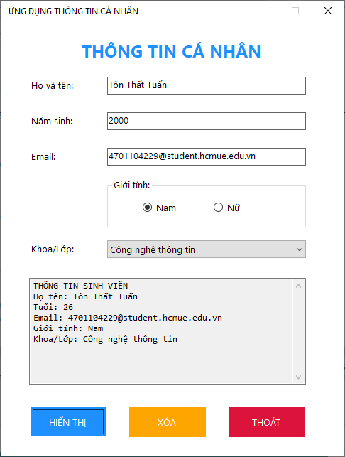
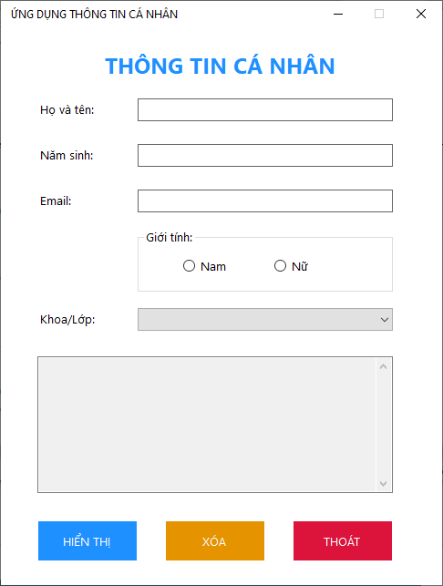
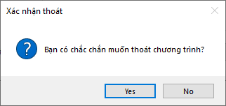

# Lab 01 ‐ Ứng dụng thông tin cá nhân

## Thông tin sinh viên

‐ Họ tên: Tôn Thất Tuấn

‐ MSSV: 47.01.104.229

‐ Lớp: 49.01.CNTT.B

## Mô tả

Xây dựng ứng dụng Windows Forms cho phép nhập thông tin cá nhân của sinh viên và hiển thị kết quả sau khi người dùng nhấn nút Hiển thị.

## Chức năng

### 1. Giao diện chính

### 2. Hiển thị

### 3. Xóa

### 4. Thoát

## Cách chạy
1. Mở file `Lab01.sln` bằng Visual Studio.
2. Build solution.
3. Chạy project (nhấn `F5` hoặc nút `Start`).