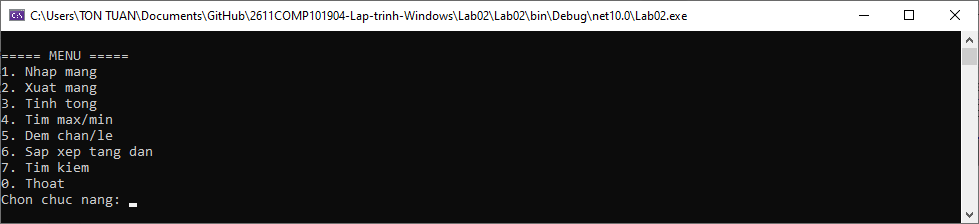
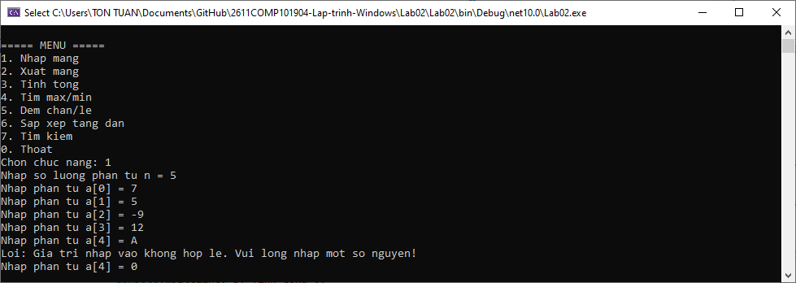
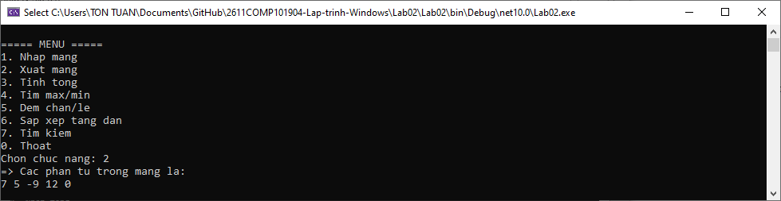
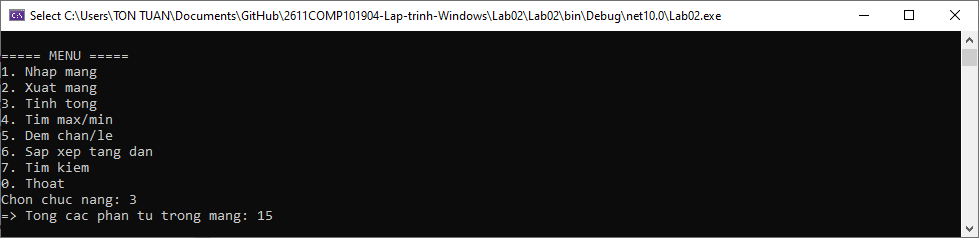
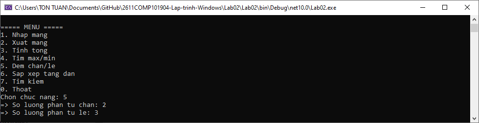
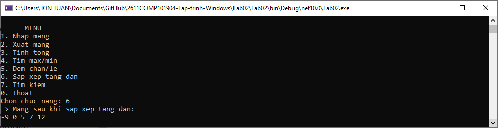
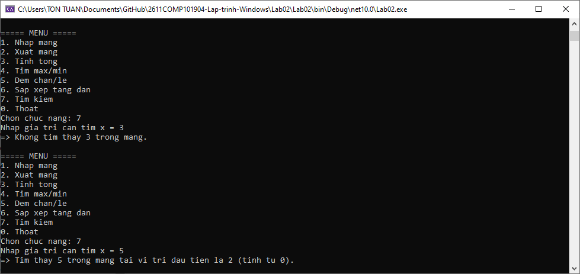
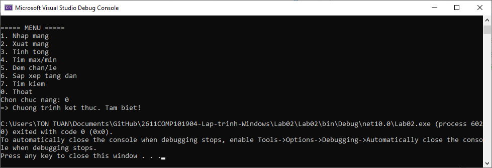

# Lab 02 - Quản lý mảng số nguyên bằng Console

## Thông tin sinh viên

‐ Họ tên: Tôn Thất Tuấn

‐ MSSV: 47.01.104.229

‐ Lớp: 49.01.CNTT.B

## Mô tả

Viết chương trình Console quản lý một mảng số nguyên. Chương trình hiển thị menu để người dùng lựa chọn chức năng. Sau khi thực hiện xong một chức năng, chương trình quay lại menu cho đến khi người dùng chọn thoát.

## Chức năng

### 1. Giao diện chính

### 2. Nhập mảng

### 3. Xuất mảng

### 4. Tính tổng

### 5. Tìm max/min

### 6. Đếm chẵn/lẻ

### 7. Sắp xếp tăng dần

### 8. Tìm kiếm

### 9. Thoát

## Cách chạy
1. Mở file `Lab02.sln` bằng Visual Studio.
2. Build solution.
3. Chạy project (nhấn `F5` hoặc nút `Start`).