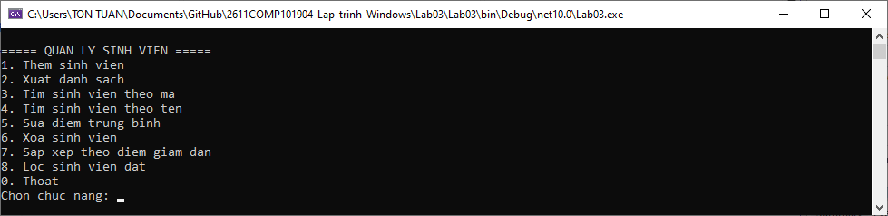
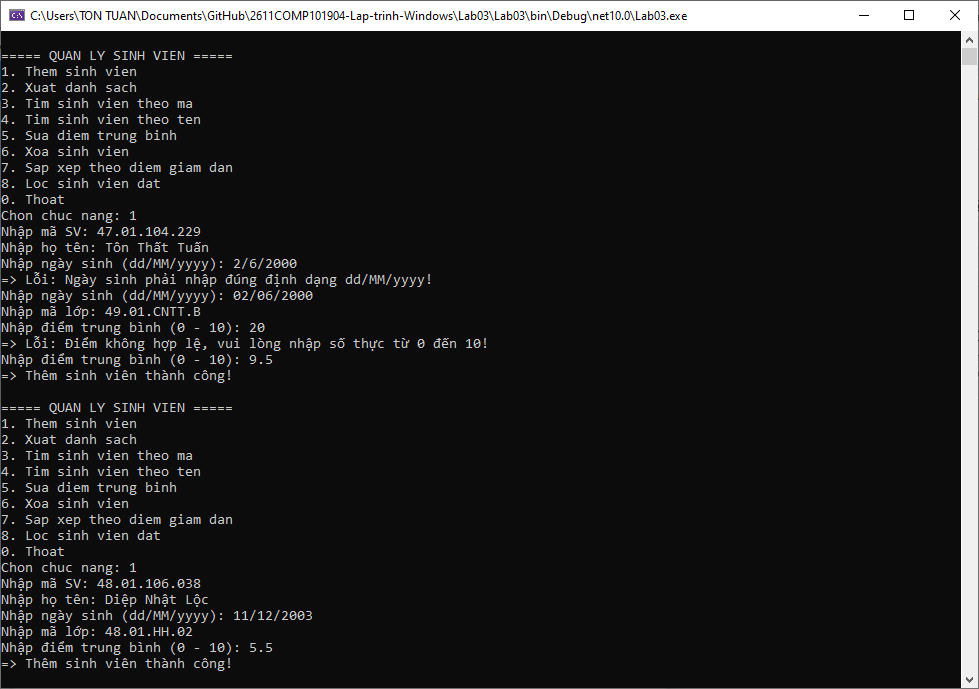
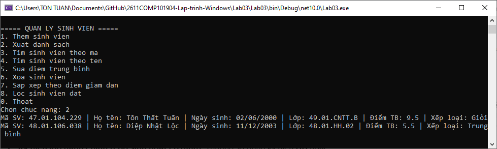
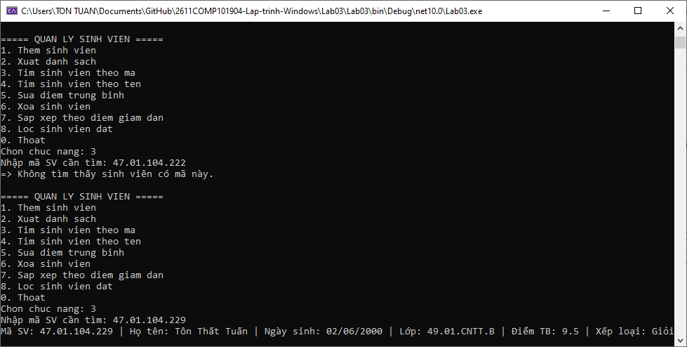
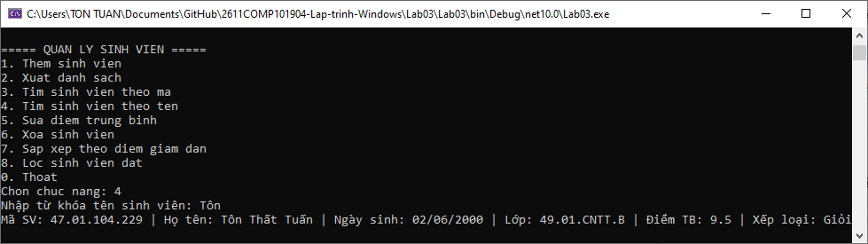
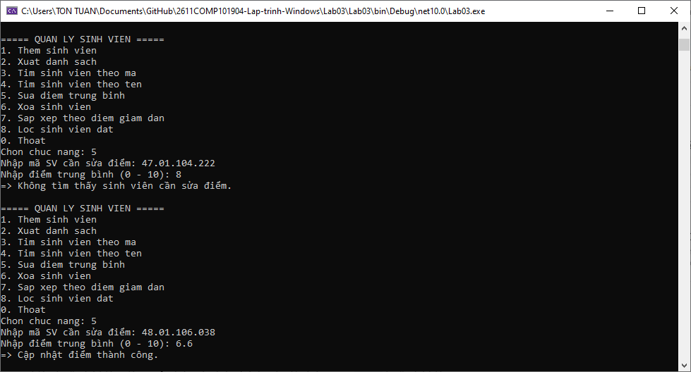
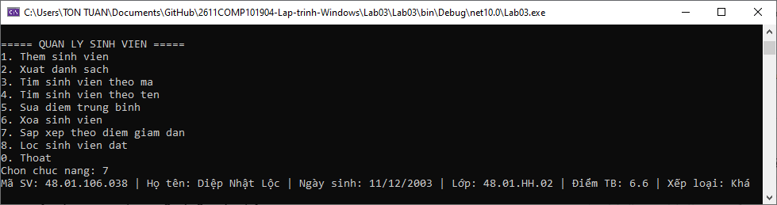
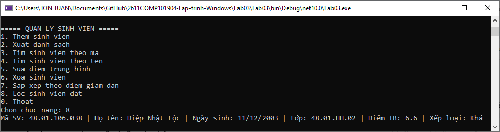
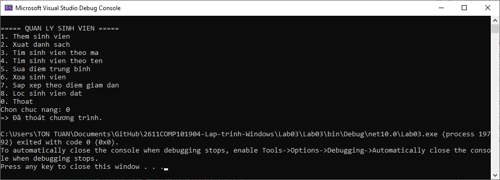

# Lab 03 - Quản lý sinh viên bằng Console

## Thông tin sinh viên

‐ Họ tên: Tôn Thất Tuấn

‐ MSSV: 47.01.104.229

‐ Lớp: 49.01.CNTT.B

## Mô tả

Viết chương trình Console quản lý sinh viên theo hướng đối tượng. Chương trình cho phép người dùng thao tác với danh sách sinh viên thông qua menu. Dữ liệu được lưu trong bộ nhớ bằng List<SinhVien>.

## Chức năng

### 1. Giao diện chính

### 2. Thêm sinh viên

### 3. Xuất danh sách

### 4. Tìm sinh viên theo mã

### 5. Tìm sinh viên theo tên

### 6. Sửa điểm trung bình

### 7. Xóa sinh viên

### 8. Sắp xếp theo điểm giảm dần

### 9. Lọc sinh viên đạt

### 10. Thoát

## Cách chạy
1. Mở file `Lab03.sln` bằng Visual Studio.
2. Build solution.
3. Chạy project (nhấn `F5` hoặc nút `Start`).