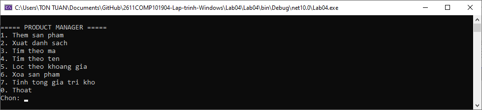
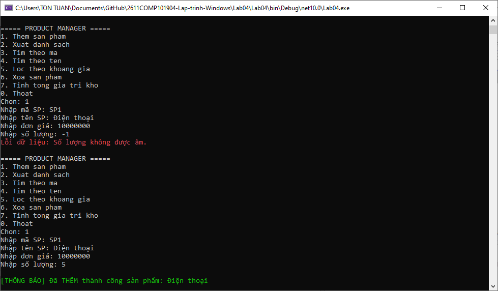
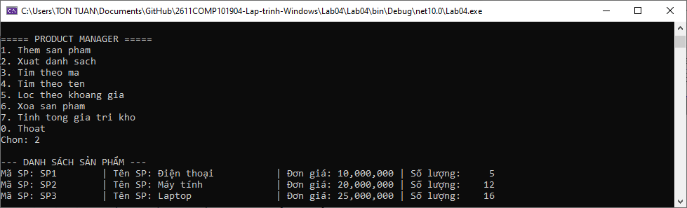
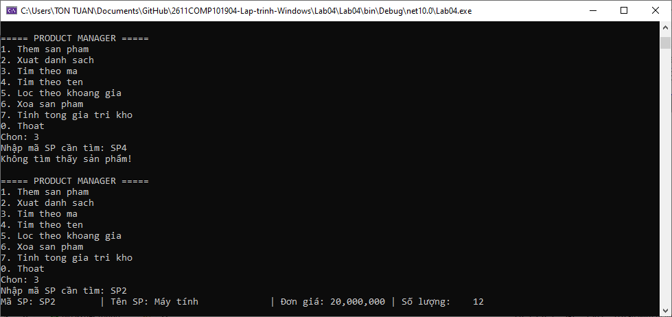
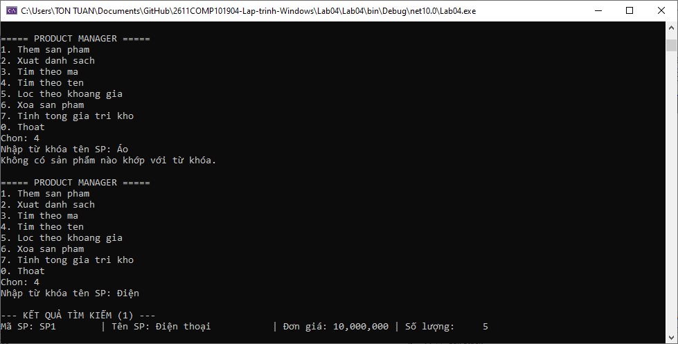
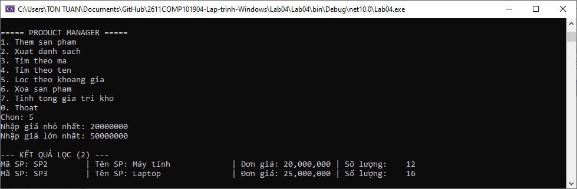
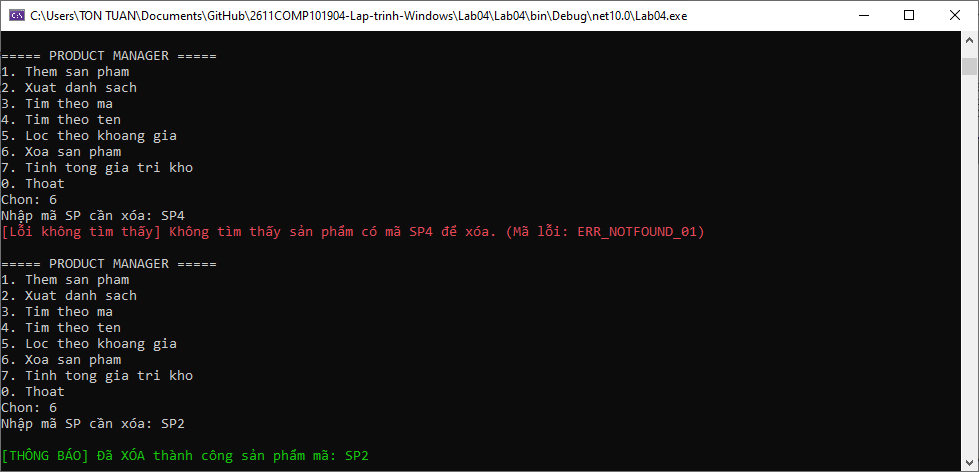
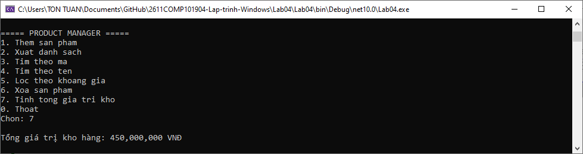
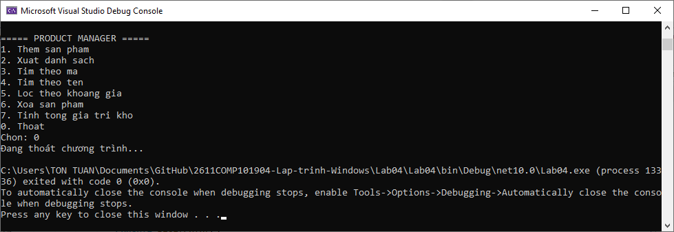

# Lab 04 - Exception, Delegate/Event, Func/Action và Generic trong C#

## Thông tin sinh viên

‐ Họ tên: Tôn Thất Tuấn

‐ MSSV: 47.01.104.229

‐ Lớp: 49.01.CNTT.B

## Mô tả

Viết chương trình Console quản lý sản phẩm. Dữ liệu được lưu trong bộ nhớ bằng một Repository<T>. Chương trình phải xử lý lỗi nhập liệu, mã sản phẩm trùng và sản phẩm không tồn tại bằng exception phù hợp.

## Chức năng

### 1. Giao diện chính

### 2. Thêm sản phẩm

### 3. Xuất danh sách

### 4. Tìm theo mã

### 5. Tìm theo tên

### 6. Lọc theo khoảng giá

### 7. Xóa sản phẩm

### 8. Tính tổng giá trị kho

### 9. Thoát

## Cách chạy
1. Mở file `Lab04.sln` bằng Visual Studio.
2. Build solution.
3. Chạy project (nhấn `F5` hoặc nút `Start`).