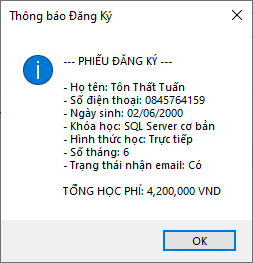
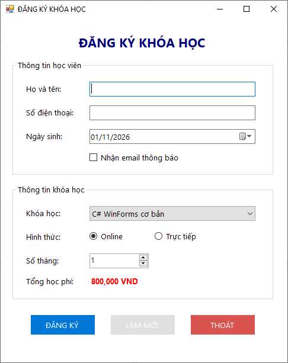
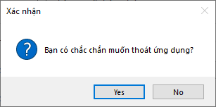

# Lab 05 - Windows Forms cơ bản

## Thông tin sinh viên

‐ Họ tên: Tôn Thất Tuấn

‐ MSSV: 47.01.104.229

‐ Lớp: 49.01.CNTT.B

## Mô tả

Sinh viên xây dựng ứng dụng WinForms tên CourseRegistrationApp dùng để đăng ký khóa học. Ứng dụng chỉ xử lý dữ liệu trên Form, chưa cần lưu cơ sở dữ liệu.

## Chức năng

### 1. Giao diện chính

### 2. Đăng ký

### 3. Làm mới

### 4. Thoát

## Cách chạy
1. Mở file `Lab05.sln` bằng Visual Studio.
2. Build solution.
3. Chạy project (nhấn `F5` hoặc nút `Start`).