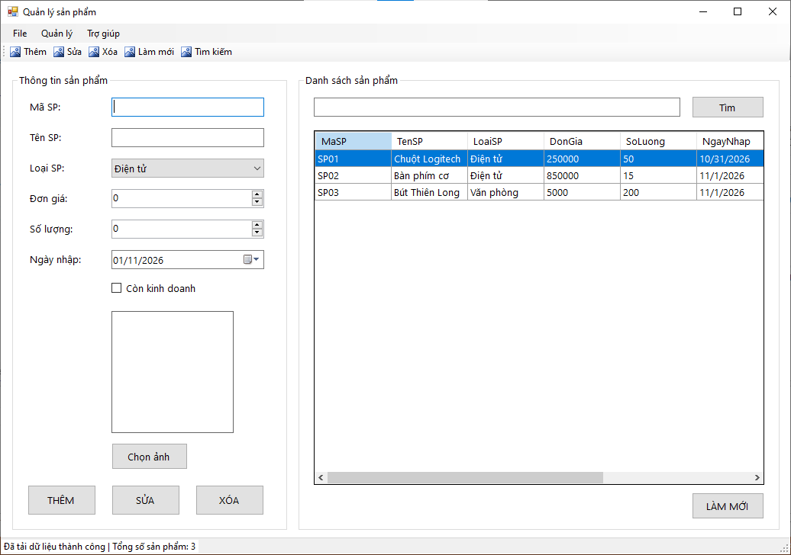
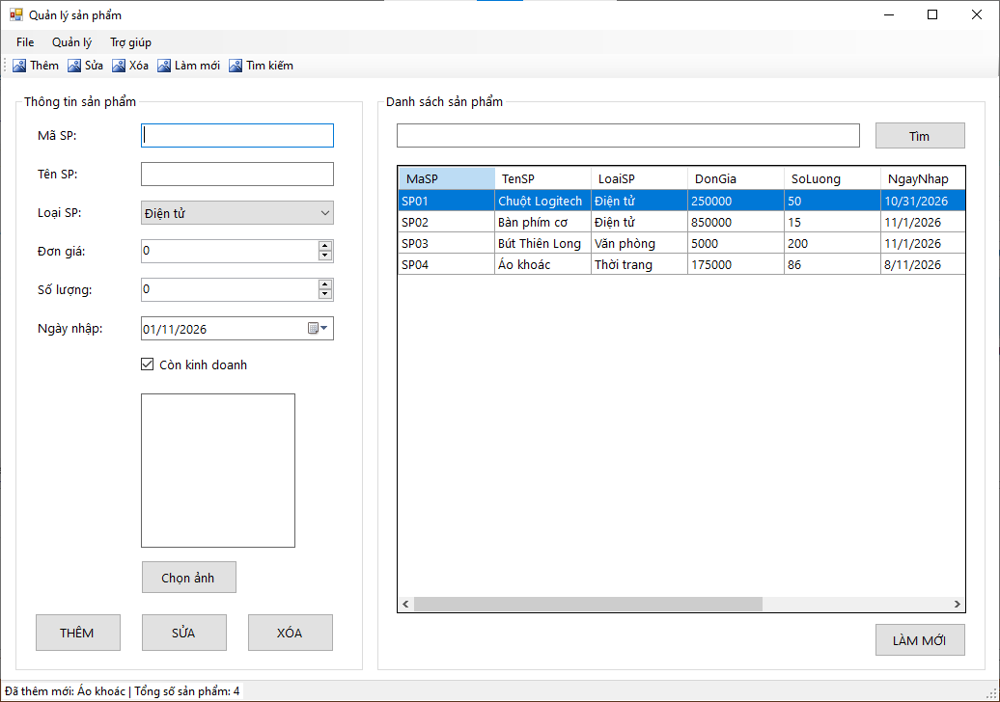
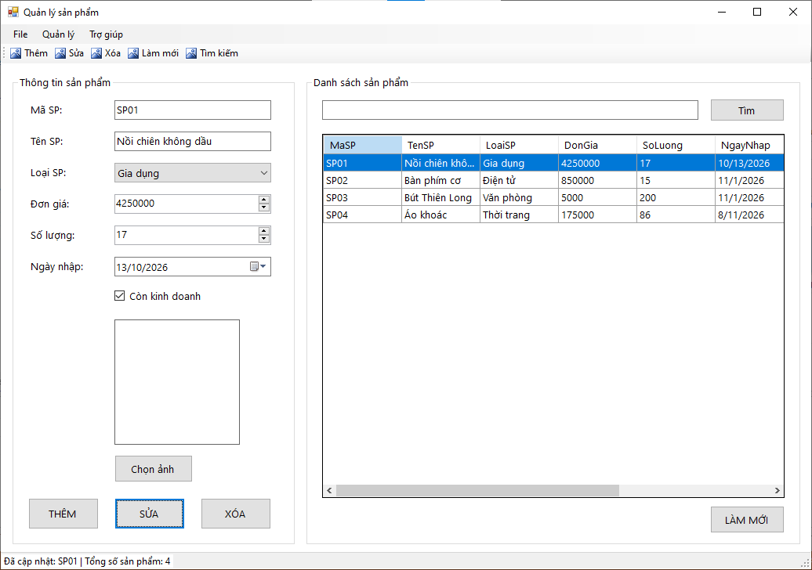
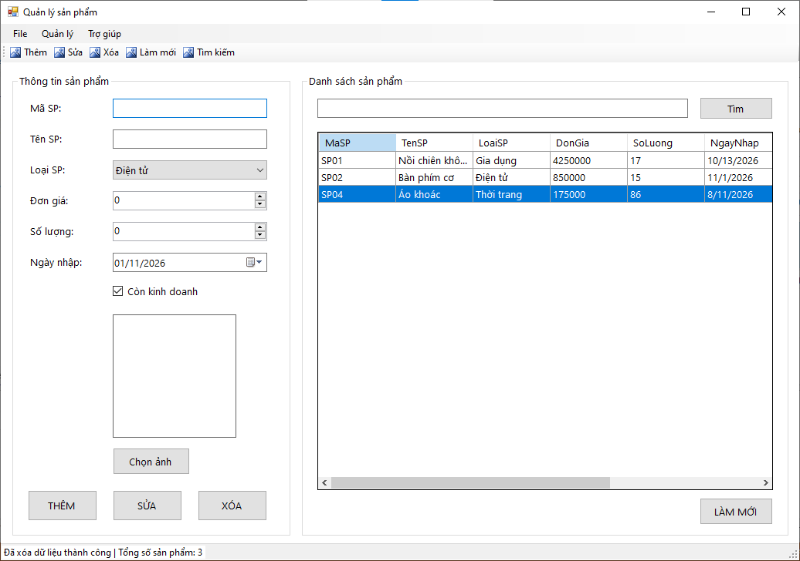
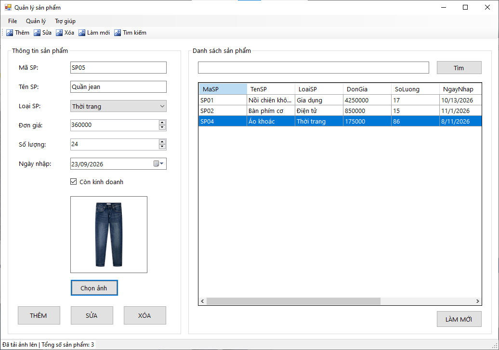
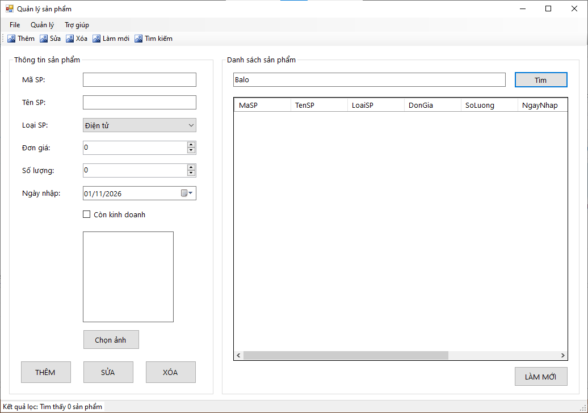
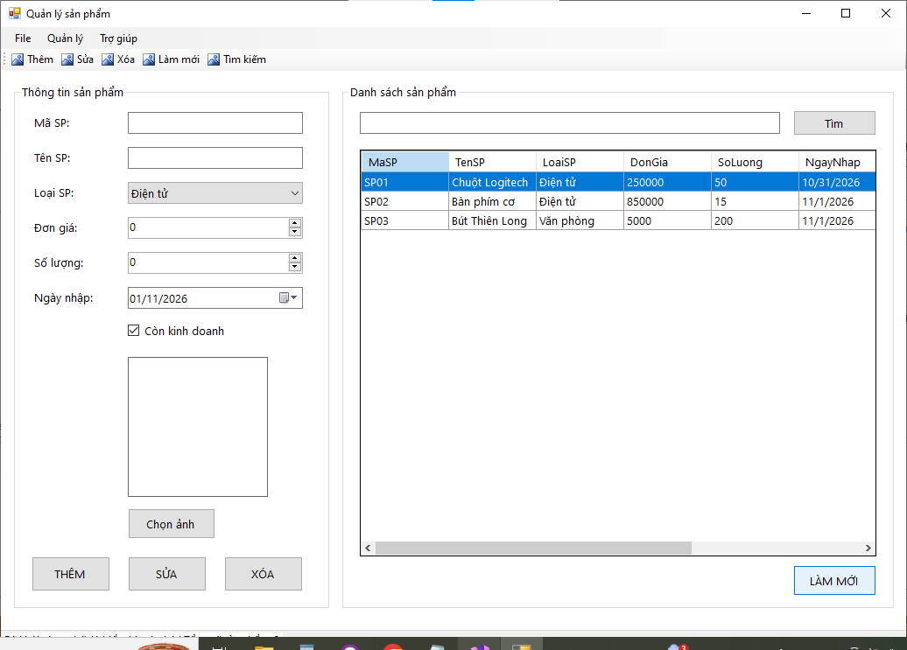
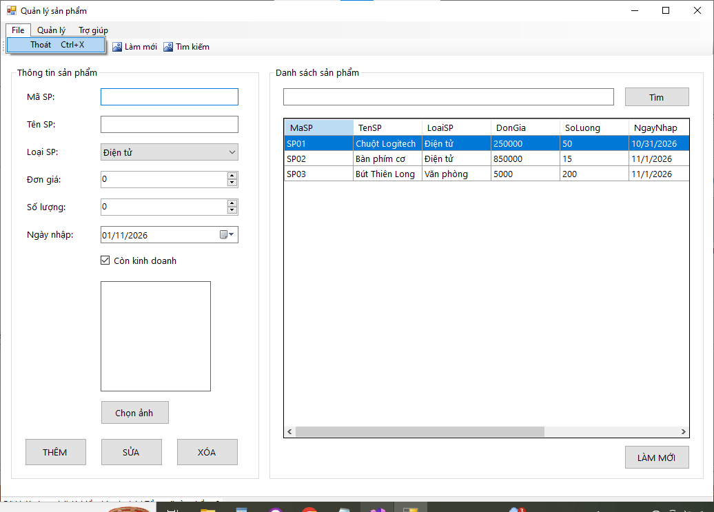

# Lab 06 - Windows Forms nâng cao và DataGridView

## Thông tin sinh viên

‐ Họ tên: Tôn Thất Tuấn

‐ MSSV: 47.01.104.229

‐ Lớp: 49.01.CNTT.B

## Mô tả

Xây dựng ứng dụng Windows Forms tên ProductManager để quản lý danh sách sản phẩm của một cửa hàng. Dữ liệu chỉ cần lưu trong bộ nhớ bằng List, BindingList hoặc BindingSource; chưa yêu cầu kết nối SQL Server.

## Chức năng

### 1. Giao diện chính

### 2. Thêm

### 3. Sửa

### 4. Xóa

### 5. Chọn ảnh

### 6. Tìm

### 7. Làm mới

### 8. Thoát

## Cách chạy
1. Mở file `Lab06.sln` bằng Visual Studio.
2. Build solution.
3. Chạy project (nhấn `F5` hoặc nút `Start`).