# Lab 07 - SDI, MDI và ứng dụng nhiều Form trong C# WinForms

## Thông tin sinh viên

‐ Họ tên: Tôn Thất Tuấn

‐ MSSV: 47.01.104.229

‐ Lớp: 49.01.CNTT.B

## Mô tả

Xây dựng ứng dụng Windows Forms có tên ShopManagerMini để quản lý cửa hàng mini. Ở buổi này chưa yêu cầu kết nối SQL Server, toàn bộ dữ liệu có thể lưu tạm bằng List<T> hoặc BindingList<T>.

## Chức năng

### 1. Đăng nhập

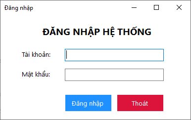

### 2. Giao diện chính
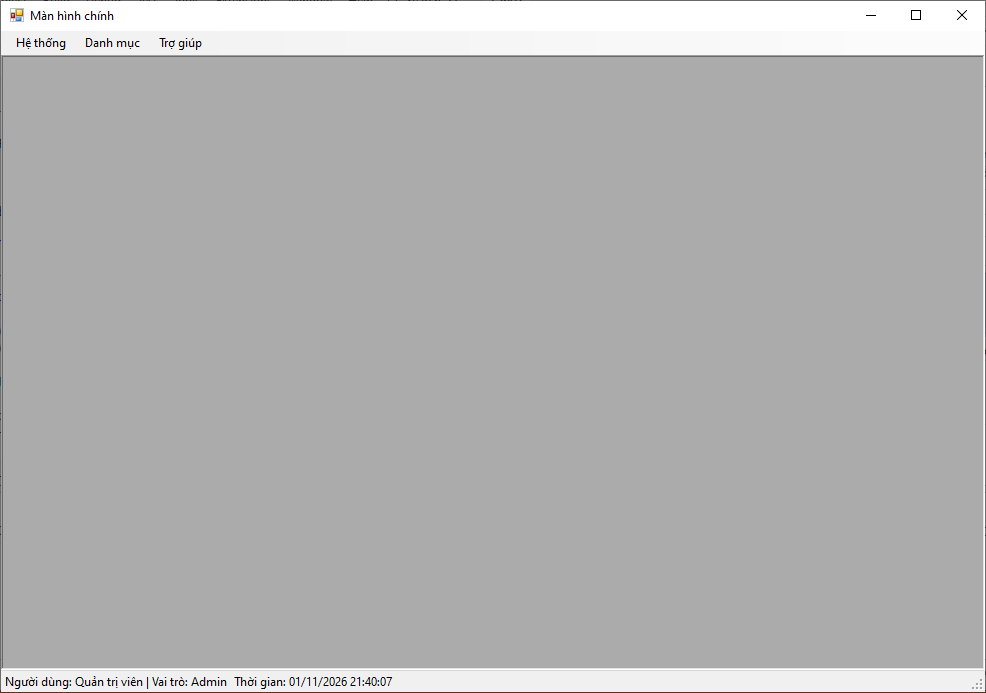

### 3. Giao diện quản lý sản phẩm
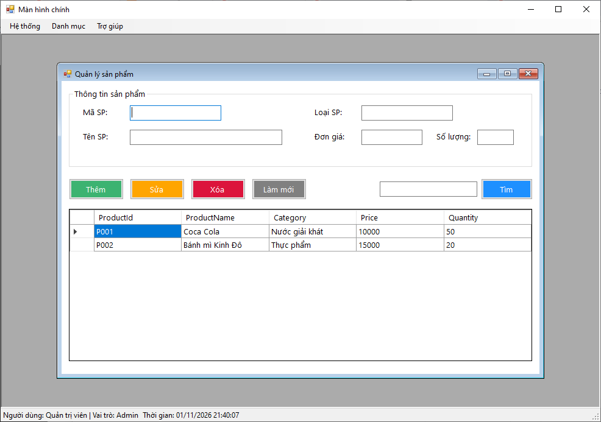

#### 3.1. Thêm

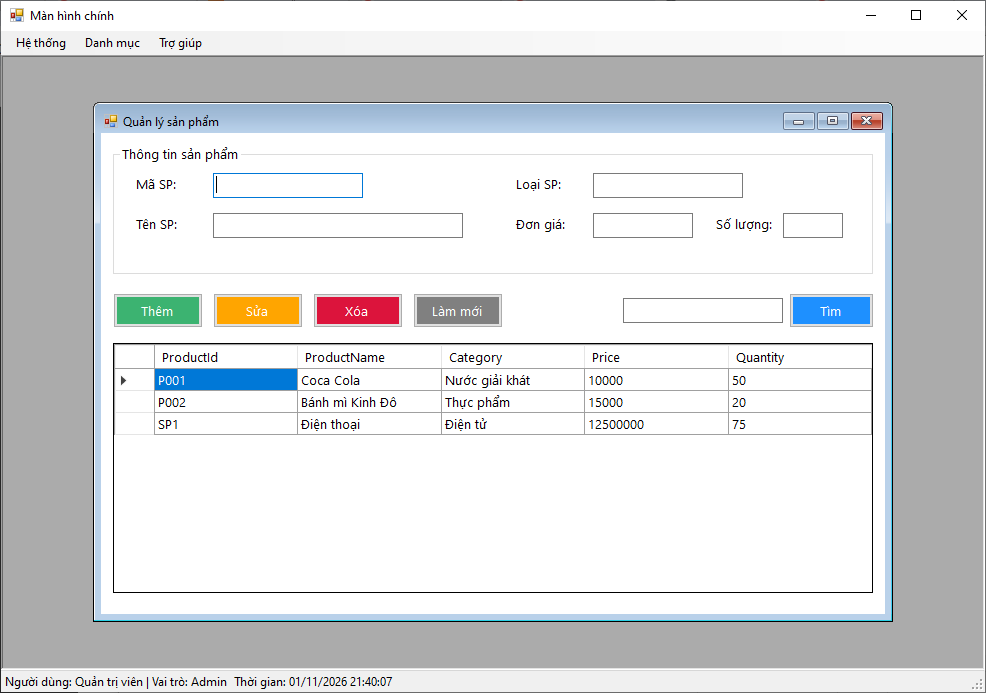

#### 3.2. Sửa

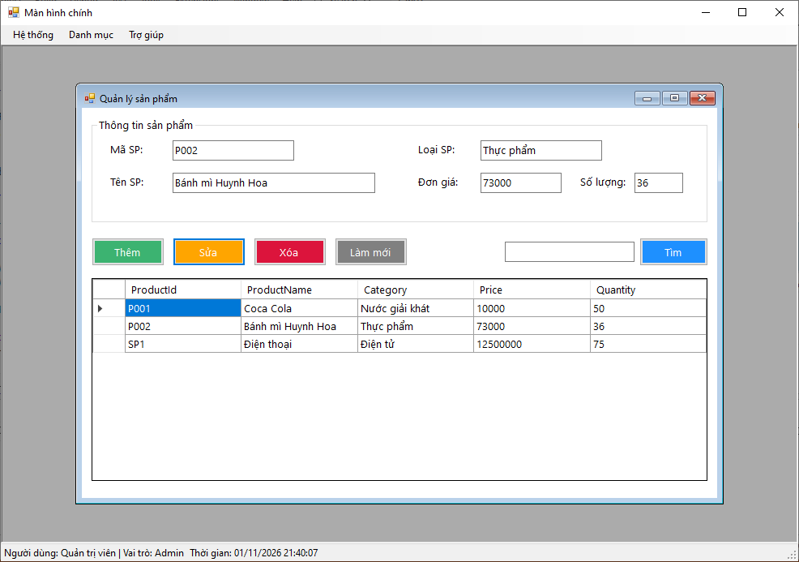

#### 3.3. Xóa

#### 3.4. Làm mới

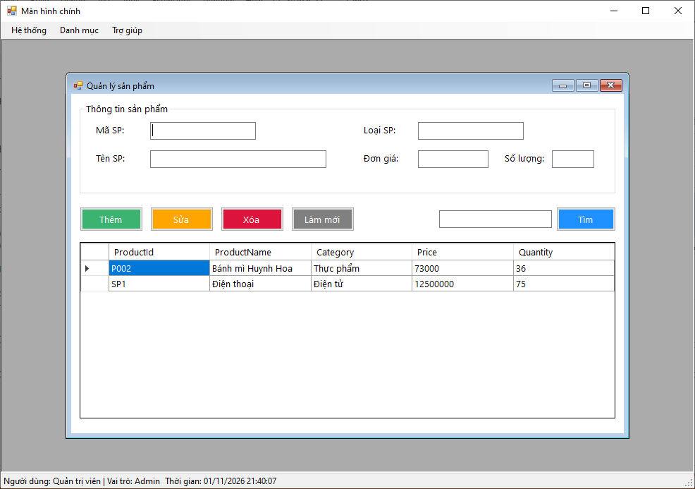

#### 3.5. Tìm

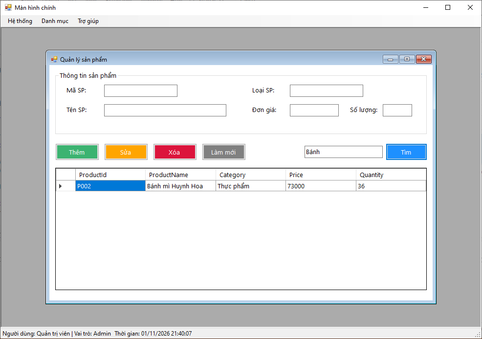

### 4. Giao diện quản lý khách hàng

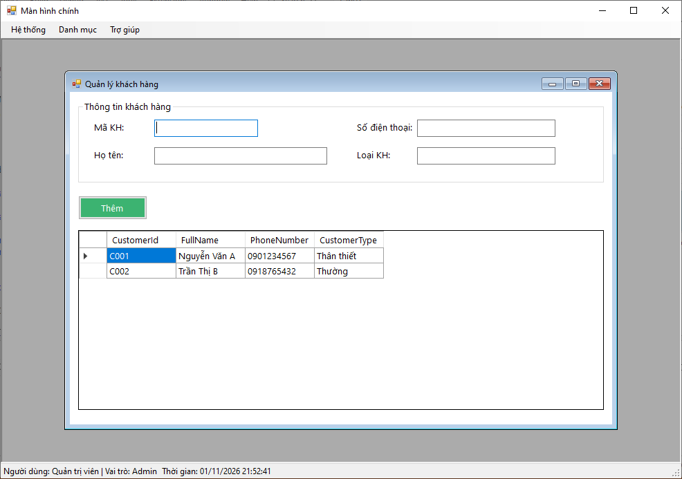

#### 4.1. Thêm

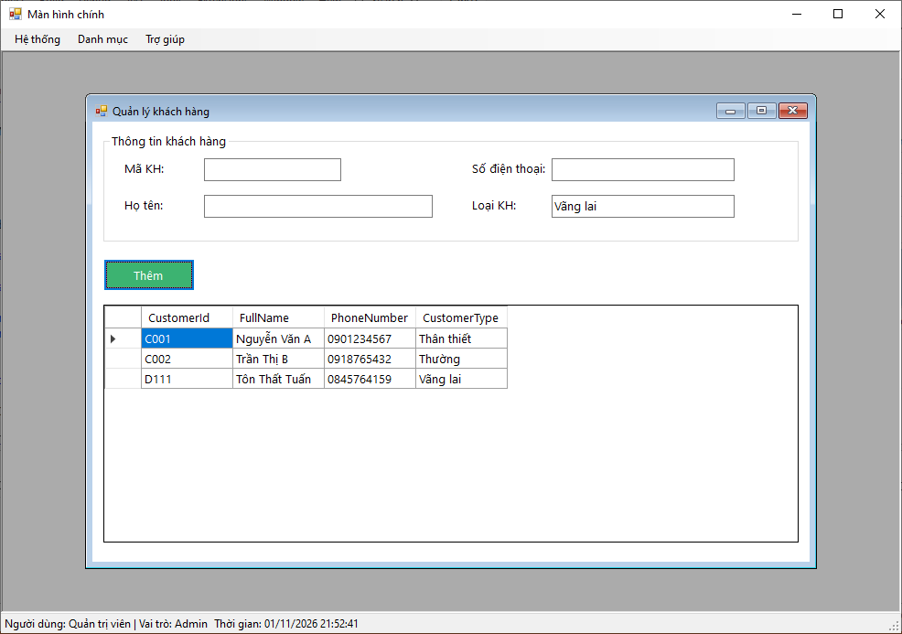

### 5. Giới thiệu

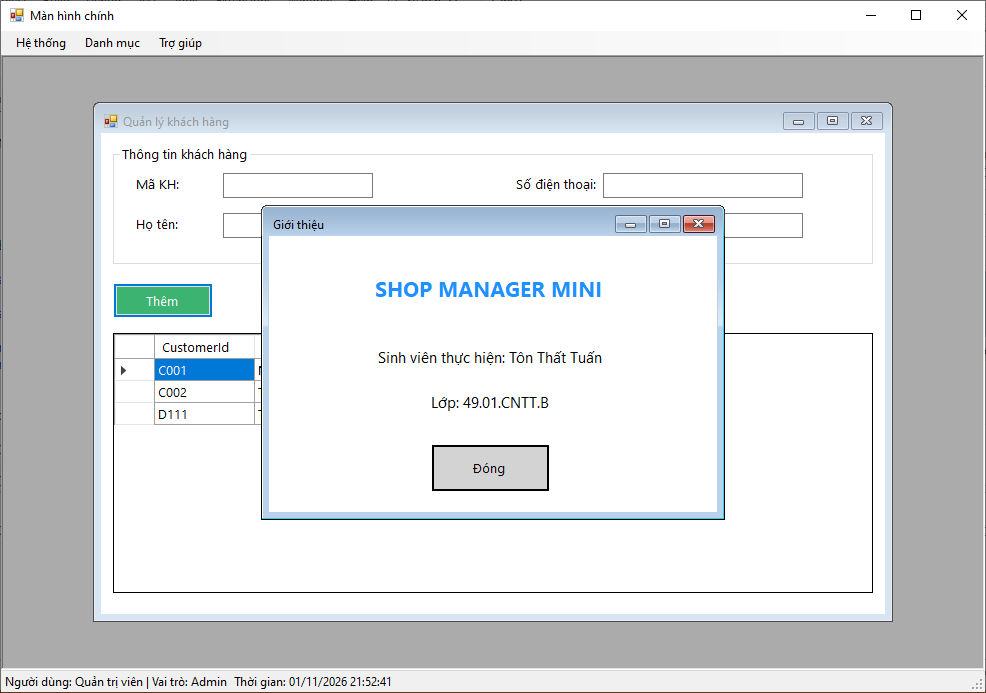

### 6. Thoát

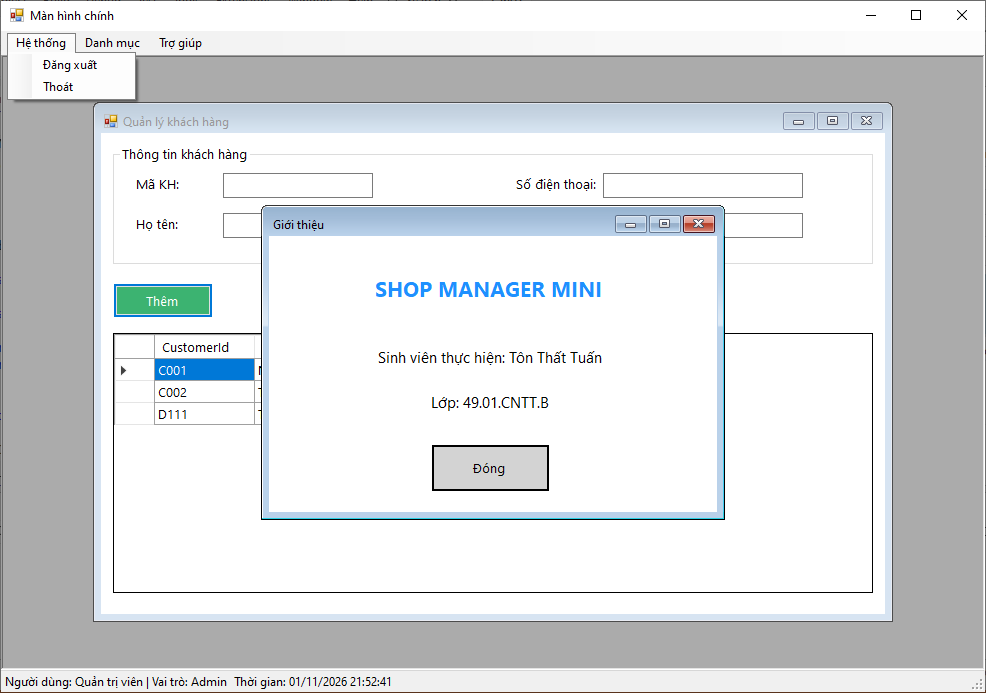

## Cách chạy
1. Mở file `Lab07.sln` bằng Visual Studio.
2. Build solution.
3. Chạy project (nhấn `F5` hoặc nút `Start`).