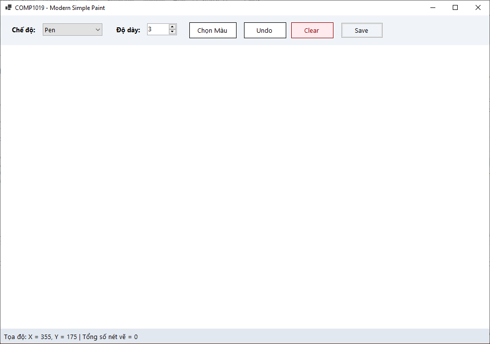
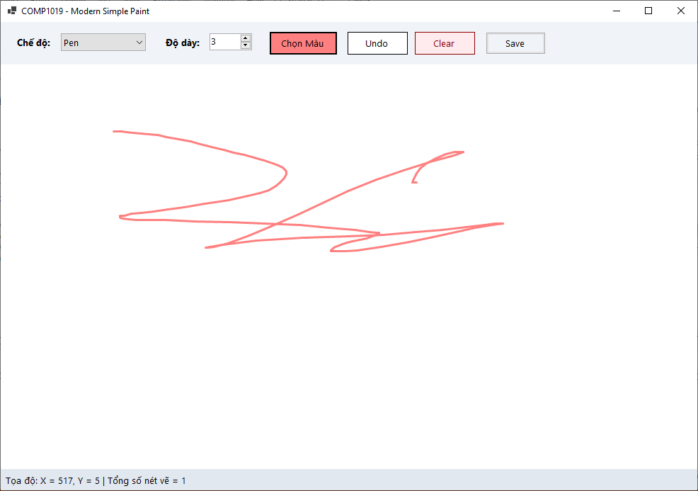
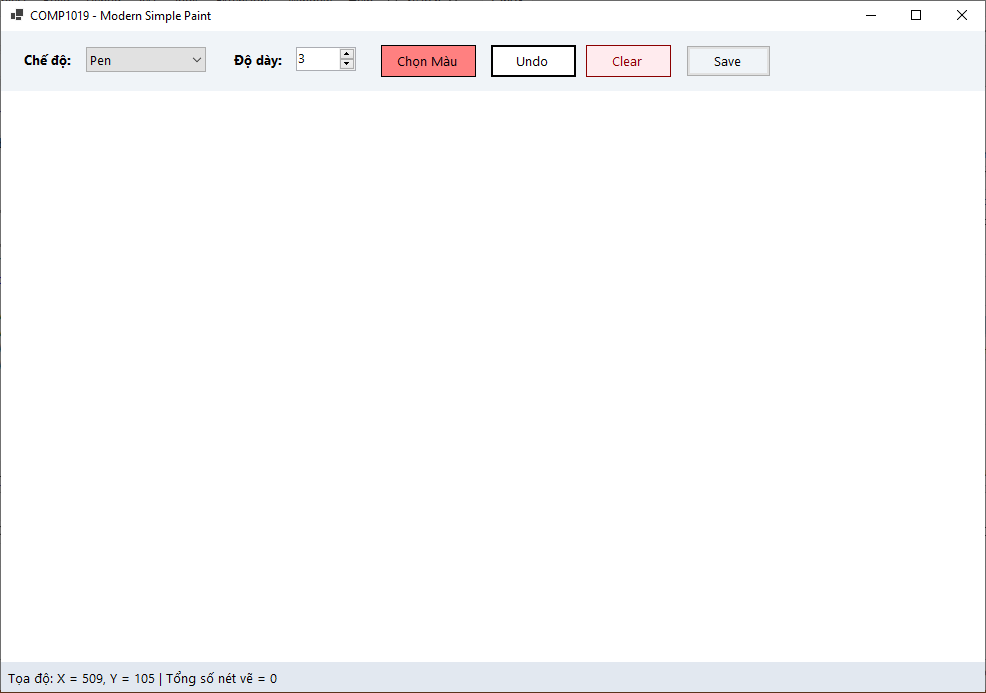
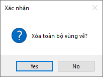
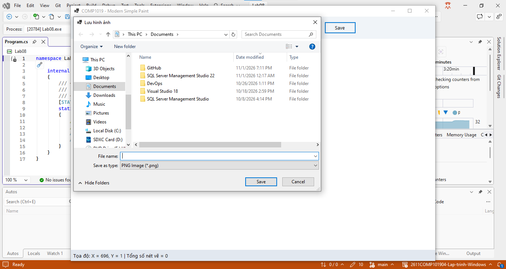

# Lab 08 - Xây dựng ứng dụng Paint đơn giản bằng WinForms và GDI+

## Thông tin sinh viên

‐ Họ tên: Tôn Thất Tuấn

‐ MSSV: 47.01.104.229

‐ Lớp: 49.01.CNTT.B

## Mô tả

Sinh viên xây dựng ứng dụng Paint đơn giản. Người dùng có thể chọn chế độ vẽ, chọn màu, chọn độ dày nét và vẽ trực tiếp trên vùng canvas bằng chuột. Các hình đã vẽ phải không bị mất khi Form bị resize hoặc bị che rồi hiện lại.

## Chức năng

### 1. Giao diện chính

### 2. Chọn màu

### 3. Undo

### 4. Clear

### 5. Save

## Cách chạy
1. Mở file `Lab08.sln` bằng Visual Studio.
2. Build solution.
3. Chạy project (nhấn `F5` hoặc nút `Start`).