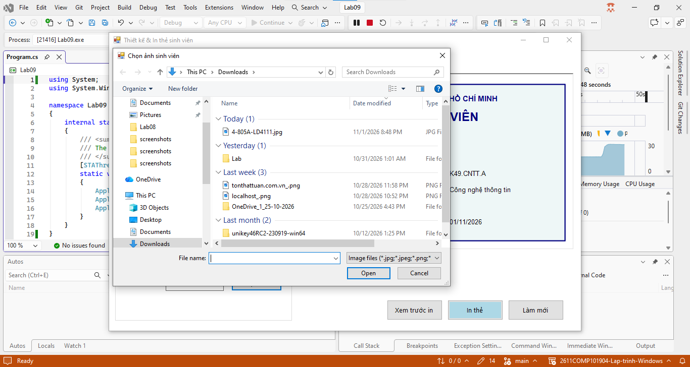
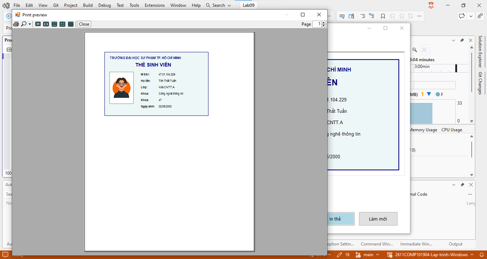
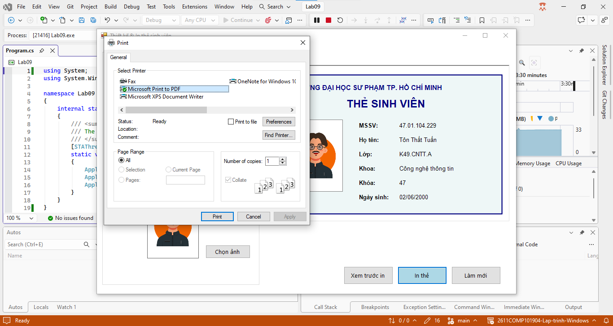
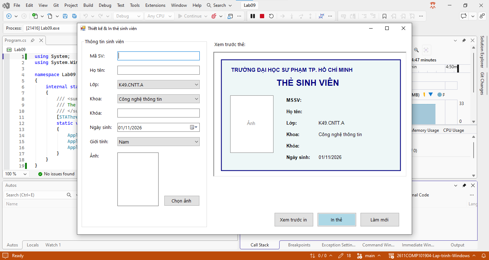

# Lab 09 - Thiết kế và in thẻ sinh viên bằng WinForms

## Thông tin sinh viên

‐ Họ tên: Tôn Thất Tuấn

‐ MSSV: 47.01.104.229

‐ Lớp: 49.01.CNTT.B

## Mô tả

Xây dựng ứng dụng Windows Forms cho phép nhập thông tin sinh viên, chọn ảnh đại diện, hiển thị bản xem trước của thẻ sinh viên và in thẻ sinh viên.

Ứng dụng không yêu cầu kết nối cơ sở dữ liệu ở buổi này. Dữ liệu được nhập trực tiếp trên Form.

## Chức năng

### 1. Giao diện chính

### 2. Chọn ảnh

### 3. Xem trước in

### 4. In thẻ

### 5. Làm mới

## Cách chạy
1. Mở file `Lab09.sln` bằng Visual Studio.
2. Build solution.
3. Chạy project (nhấn `F5` hoặc nút `Start`).