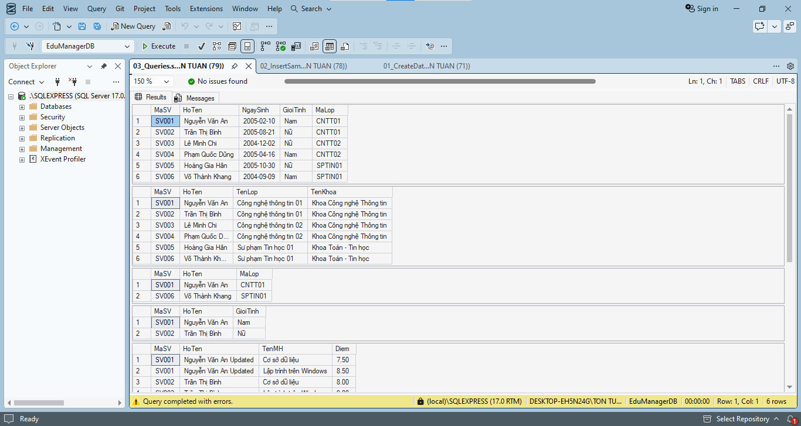
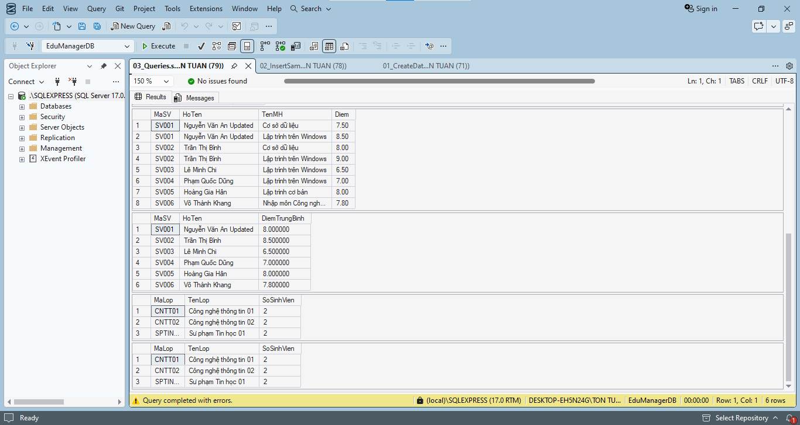

# Lab 10 - Thiết kế và cài đặt cơ sở dữ liệu EduManagerDB bằng SQL Server

## Thông tin sinh viên

‐ Họ tên: Tôn Thất Tuấn

‐ MSSV: 47.01.104.229

‐ Lớp: 49.01.CNTT.B

## Mô tả

Xây dựng cơ sở dữ liệu EduManagerDB cho ứng dụng quản lý sinh viên. Cơ sở dữ liệu cần quản lý các thông tin: khoa, lớp, sinh viên, môn học, kết quả học tập và tài khoản đăng nhập.

## Truy vấn chính

## Cách chạy
1. Mở file `03_Queries.sql` bằng SQL Server Management Studio.
2. Chạy file (nhấn `Execute` hoặc nút `Alt + X`).