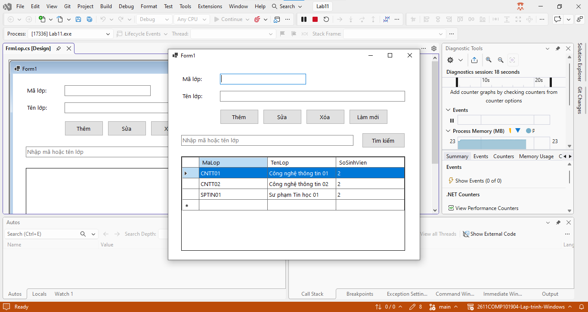
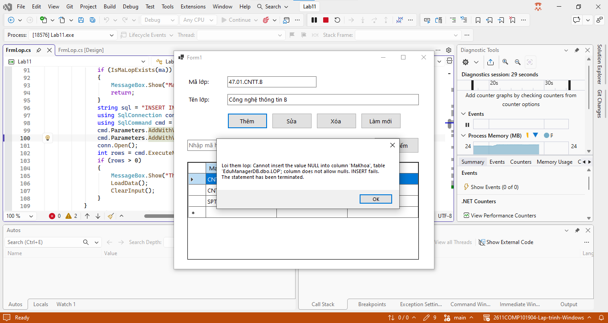
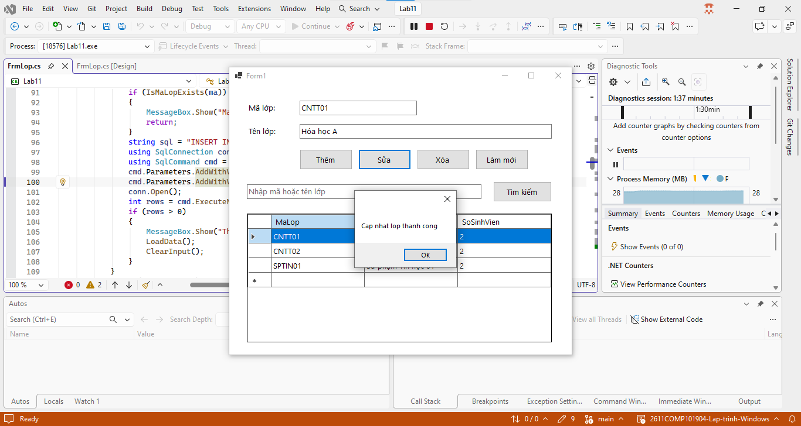
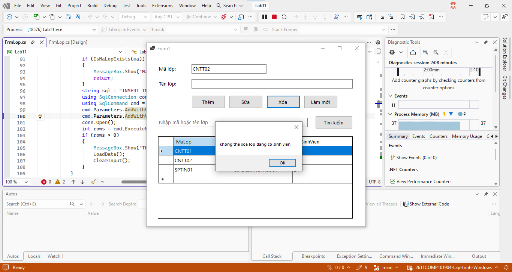
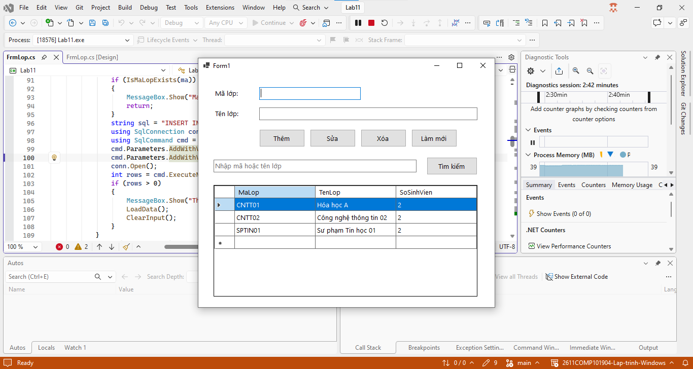
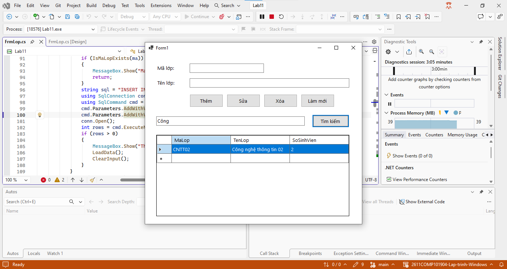

# Lab 11 - ADO.NET và CRUD với SQL Server

## Thông tin sinh viên

‐ Họ tên: Tôn Thất Tuấn

‐ MSSV: 47.01.104.229

‐ Lớp: 49.01.CNTT.B

## Mô tả

Sinh viên xây dựng Form quản lý lớp học. Dữ liệu lớp học được lưu trong SQL Server, không lưu tạm bằng List<T>.

## Chức năng

### 1. Giao diện chính

### 2. Thêm

### 3. Sửa

### 4. Xóa

### 5. Làm mới

### 6. Tìm kiếm

## Cách chạy
1. Mở file `Lab11.sln` bằng Visual Studio.
2. Build solution.
3. Chạy project (nhấn `F5` hoặc nút `Start`).