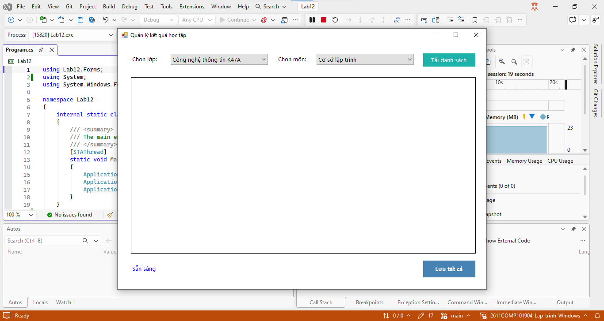
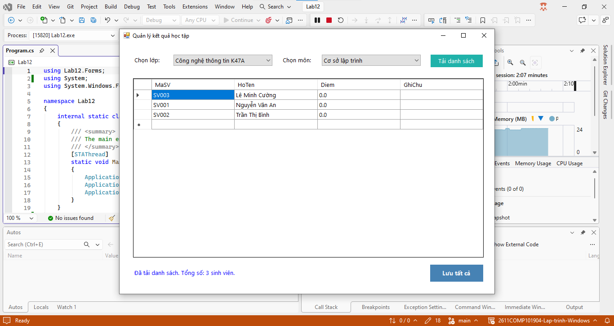
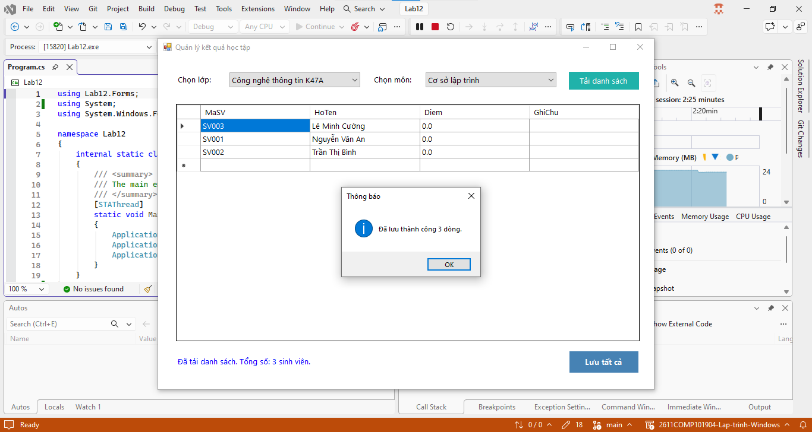

# Lab 12 - Data Binding, Stored Procedure và Transaction

## Thông tin sinh viên

‐ Họ tên: Tôn Thất Tuấn

‐ MSSV: 47.01.104.229

‐ Lớp: 49.01.CNTT.B

## Mô tả

Xây dựng module Quản lý kết quả học tập. Người dùng chọn lớp, chọn môn học, hệ thống hiển thị danh sách sinh viên của lớp đó. Người dùng nhập điểm cho từng sinh viên và bấm Lưu tất cả. Nếu tất cả dữ liệu hợp lệ thì lưu xuống database. Nếu có bất kỳ dòng nào lỗi thì hủy toàn bộ thao tác lưu.

## Chức năng

### 1. Giao diện chính

### 2. Tải danh sách

### 3. Lưu tất cả

## Cách chạy
1. Mở file `Lab12.sln` bằng Visual Studio.
2. Build solution.
3. Chạy project (nhấn `F5` hoặc nút `Start`).