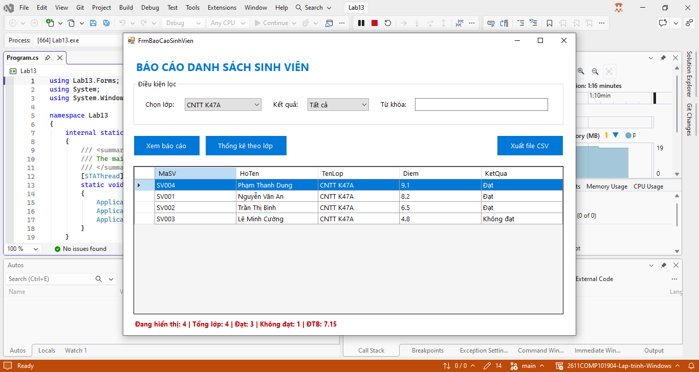
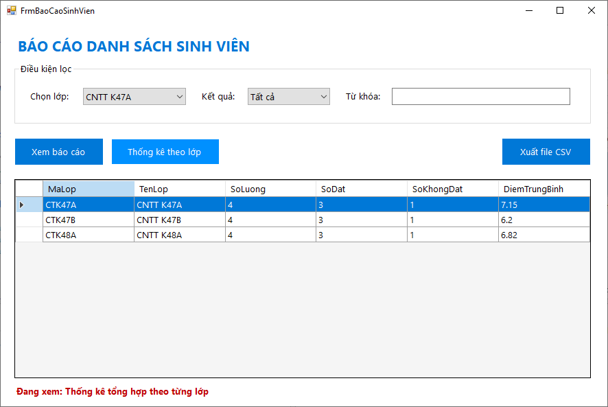
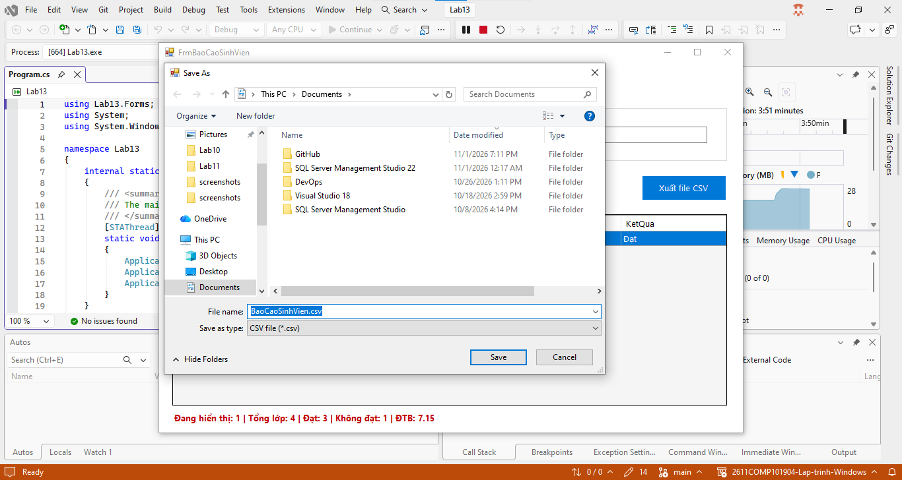

# Lab 13 - Báo cáo sinh viên bằng LINQ

## Thông tin sinh viên

‐ Họ tên: Tôn Thất Tuấn

‐ MSSV: 47.01.104.229

‐ Lớp: 49.01.CNTT.B

## Mô tả

Xây dựng module Báo cáo danh sách sinh viên theo lớp. Người dùng chọn lớp, chọn điều kiện kết quả học tập, bấm nút Xem báo cáo. Chương trình dùng LINQ để lọc, sắp xếp, thống kê và hiển thị dữ liệu. Người dùng có thể xuất kết quả báo cáo ra file CSV hoặc TXT.

## Chức năng

### 1. Giao diện chính

### 2. Thống kê theo lớp

### 3. Tìm kiếm

### 4. Xuất file CSV

## Cách chạy
1. Mở file `Lab13.sln` bằng Visual Studio.
2. Build solution.
3. Chạy project (nhấn `F5` hoặc nút `Start`).